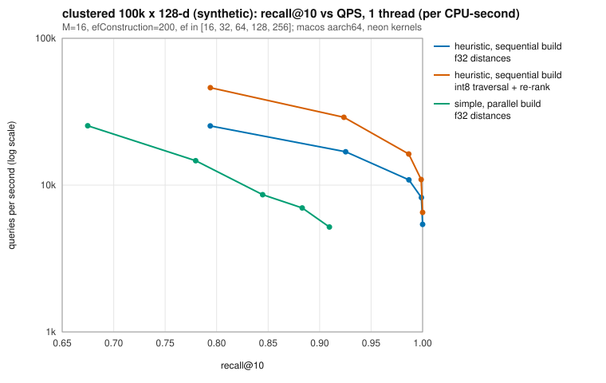

# hnsw-index

[](https://github.com/aozmekik/hnsw-index/actions/workflows/ci.yml)
[](LICENSE)

A from-scratch Rust implementation of HNSW graphs for approximate nearest
neighbor search, with SIMD distance kernels, filtered search, deletions and
a validated on-disk format.

> **Status:** early, version 0.1.0. The API may change. Not yet published to
> crates.io.

## Why it exists

HNSW (Malkov & Yashunin) is the graph index behind many vector search
systems. This crate implements it directly from the paper, as a compact,
readable codebase that is also careful about the parts papers leave out:
searching from many threads without data races, building in parallel without
deadlocks, deleting vectors, and loading index files that may be corrupt or
hostile with an error instead of a crash. On identical data, its recall is
within 0.01 of [hnswlib](https://github.com/nmslib/hnswlib), the authors'
C++ library, at `ef ≥ 32` ([below](#correctness)).

## Features

- **The paper's algorithms**: insertion with level sampling (`mL = 1/ln M`),
  greedy descent through the upper layers, ef-bounded search on layer 0, and
  both neighbor selection strategies, simple (Algorithm 3) and heuristic
  (Algorithm 4, with optional `extendCandidates` and `keepPrunedConnections`).
  Parameters `M`, `M0` and `efConstruction`.
- **Metrics**: squared L2, inner product and cosine over fixed-dimension `f32`
  vectors.
- **SIMD kernels**: a 16-accumulator loop that LLVM auto-vectorizes, plus
  hand-written NEON (aarch64) and AVX2+FMA (x86_64) kernels chosen by runtime
  feature detection, each tested against a scalar reference.
- **Filtered search**: `search_filtered(query, k, ef, |key| ...)` applies the
  predicate during traversal, so it still returns `k` matches when most keys
  are rejected.
- **Deletion**: tombstones excluded from results immediately; `compact()`
  rebuilds without them.
- **Concurrency**: `HnswIndex` is `Send + Sync`; search takes `&self`.
  `insert_batch` links vectors in parallel with rayon; `search_batch` searches
  in parallel.
- **Persistence**: a versioned, CRC-32 checksummed binary format. Loading
  validates every field and checks the memory the file would need against a
  limit before allocating it, so corrupt or malicious files produce errors,
  not panics or out-of-memory aborts.
- **Optional int8 scalar quantization**: graph traversal on 8-bit codes, then
  exact `f32` re-ranking.
- **Exact `BruteForceIndex`** for ground truth, `eval::recall_at_k`, and seeded
  synthetic datasets.
- Two runtime dependencies: `rayon` and `parking_lot`.

## Install

Not yet published to crates.io. Use it as a git dependency:

```toml
[dependencies]
hnsw-index = { git = "https://github.com/aozmekik/hnsw-index", tag = "v0.1.0" }
```

The benchmark binary installs with

```sh
cargo install --locked --git https://github.com/aozmekik/hnsw-index --tag v0.1.0 --bin hnsw-bench
```

(CI runs the same command against its own checkout.)

Requires Rust 1.88 or newer (edition 2024).

## Quick start

```rust
use hnsw_index::{HnswIndex, HnswParams, Metric};

fn main() -> Result<(), hnsw_index::Error> {
    let mut index = HnswIndex::new(3, Metric::Cosine, HnswParams::default())?;
    index.insert(1, &[1.0, 0.0, 0.0])?;
    index.insert(2, &[0.0, 1.0, 0.0])?;
    index.insert_batch(&[3, 4], &[0.9, 0.1, 0.0, 0.0, 0.0, 1.0])?; // flat, row-major

    // The 2 nearest neighbors, with a candidate list of size ef = 32.
    let hits = index.search(&[1.0, 0.05, 0.0], 2, 32)?;
    assert_eq!(hits[0].key, 1);

    // Only even keys.
    let even = index.search_filtered(&[1.0, 0.05, 0.0], 1, 32, |key| key % 2 == 0)?;
    assert_eq!(even[0].key, 2);

    index.remove(1);
    let path = std::env::temp_dir().join("quickstart.hnsw");
    index.write_to(std::fs::File::create(&path)?)?;
    let loaded = HnswIndex::read_from(std::fs::File::open(&path)?)?;
    assert_eq!(loaded.search(&[1.0, 0.05, 0.0], 1, 32)?[0].key, 3);
    Ok(())
}
```

This example is compiled and run by `cargo test --doc`, so it cannot drift
from the API.

Runnable examples live in [`examples/`](examples): `quickstart`,
`filtered_search`, `persistence` and `quantization`
(`cargo run --release --example quickstart`).

## API overview

| Item | Purpose |
|---|---|
| `HnswIndex::new(dim, metric, params)` | Empty index; validates `dim` and parameters. |
| `HnswParams::new(m)` | `M`, with `M0 = 2M` and `mL = 1/ln M` (the paper's recommendations) and `efConstruction = 200` (hnswlib's default); builder methods `with_m0`, `with_ef_construction`, `with_level_multiplier`, `with_selection`, `with_seed`. |
| `insert(key, &[f32])`, `insert_batch(&keys, &flat)`, `reserve(n)` | Add vectors under caller-chosen `u64` keys. A batch is validated as a whole before anything is inserted and linked in parallel. |
| `search(q, k, ef)`, `search_filtered(q, k, ef, f)`, `search_with(q, k, &SearchOptions)`, `search_batch(&flat, k, ef)` | Approximate k-NN, closest first, as `Neighbor { key, distance }`. |
| `remove(key)`, `compact()` | Tombstone a key; rebuild without tombstones. |
| `enable_quantization()`, `SearchOptions::quantized(true)` | int8 traversal with exact re-ranking. |
| `write_to(w)`, `read_from(r)`, `to_bytes()`, `from_bytes(&[u8])`, `from_bytes_with_limit(&[u8], max_memory)` | Persistence; loading validates untrusted input and limits memory. |
| `len`, `contains`, `get`, `stats`, `memory_usage`, `backend` | Introspection. |
| `BruteForceIndex` | Exact search with the same API shape. |
| `kernels::{Backend, Kernels}` | Distance primitives per SIMD backend. |
| `synthetic::Dataset`, `eval::recall_at_k` | Seeded test data and evaluation. |

Errors are a single `Error` enum (`DimensionMismatch`, `NonFiniteVector`,
`ZeroVector`, `DuplicateKey`, `Format(FormatError)`, ...). Distances for
`Metric::L2` are squared; inner product is reported as `-<a, b>` so that
smaller is always closer.

## Design notes

- **Graph storage and concurrency** ([ADR 0001](docs/adr/0001-graph-storage-and-concurrency.md)).
  Neighbor lists are fixed-capacity blocks of `AtomicU32` (count, then ids):
  one contiguous array for layer 0, a boxed slice per node for upper layers.
  Writers take a per-node lock and publish the count last; readers never lock.
  Neighbor ids are `Relaxed` loads (plain loads); the count is an `Acquire`
  load, free on x86-64 and an `LDAPR` on AArch64, once per list. The graph
  code has no `unsafe`. Every critical section holds a single node lock,
  which makes parallel builds deadlock-free. An earlier version that held the
  inserted node's lock for its whole insertion (as hnswlib does) deadlocked
  under the property tests; the ADR explains why.
- **Levels by hashing.** A node's level is `⌊−ln(U)·mL⌋` with `U` derived from
  a hash of `(seed, id)`, not from a shared RNG, so levels do not depend on
  thread scheduling. Sequential builds are reproducible bit for bit on the
  same CPU and kernel backend (backends round differently); parallel builds
  are not (interleaving changes the graph) but match in quality.
- **Deletion** ([ADR 0002](docs/adr/0002-tombstone-deletion-and-compaction.md)).
  Tombstoned nodes keep routing searches but are never returned; `compact()`
  rebuilds from live vectors. In-place graph repair was not attempted.
- **File format** ([ADR 0003](docs/adr/0003-file-format.md)). Fixed header,
  columnar sections, CRC-32 trailer. The loader checks magic, version and
  checksum, then every invariant. Because neighbor lists have a fixed
  capacity, a small file can describe a large index, so before allocating
  graph storage the loader checks that every list is present and that the
  described index fits a memory limit (64 times the input size or 64 MiB by
  default; `from_bytes_with_limit` sets another).
- **Quantization** ([ADR 0004](docs/adr/0004-scalar-quantization.md)).
  Symmetric int8 codes with one global scale (per-dimension centering for L2),
  exact integer distances, used only to navigate; the final `ef` candidates
  are re-ranked with `f32` distances. It costs memory (codes are added) and
  buys speed.
- **Filters and tombstones** use the same mechanism: rejected nodes are
  expanded but never enter the result heap, and the search keeps going until it
  has `ef` admissible results or runs out of reachable nodes.

## Correctness

- **Tests** (`cargo test --all-targets`): unit tests with access to graph
  internals (structural invariants after every build mode, reachability,
  deterministic sequential builds); property tests with proptest (results
  sorted, at most `k`, unique, never tombstoned, filter respected, reported
  distances bit-identical to a recomputation, compaction keeps exactly the
  live keys, serialization round trip, random truncation and byte mutation of
  files never panic); SIMD-versus-scalar equivalence for every available
  backend; concurrency tests; hand-crafted index files that must be rejected
  without allocating (`tests/hostile_files.rs`); and checks of
  `memory_usage()` and of the peak memory of `compact()` against a counting
  allocator. The quick start above runs as a doctest.
- **Recall regression** (`tests/recall.rs`; fixed seed, synthetic Gaussian
  10k × 128, 200 queries, `efConstruction = 200`): recall@10 ≥ 0.95 at
  `ef = 100` with `M = 32`. With `M = 16` the same data gives lower recall,
  for hnswlib too, so that test checks that the crate stays within 0.02 of
  hnswlib's 0.8890. On the M1 Pro, `cargo test --test recall -- --nocapture`
  prints 0.9620 and 0.8900.
- **Recall compared with hnswlib**: on identical vectors, recall@10 is within
  0.01 of hnswlib 0.8.0 at every `ef ≥ 32` in all four configurations
  measured (10k Gaussian with `M = 16` and `M = 32`; 100k Gaussian and
  clustered with `M = 16`), and up to 0.025 lower at `ef = 16`. Tables and
  commands are in [docs/benchmarks.md](docs/benchmarks.md#recall-compared-with-hnswlib).

## Benchmarks

Synthetic data only: 100,000 base vectors and 1,000 disjoint queries, 128
dimensions, seed 42, Gaussian or clustered. `M = 16`, `efConstruction = 200`,
k = 10, L2. Apple M1 Pro (6 performance + 2 efficiency cores), 16 GB RAM,
macOS 26.6.2, rustc 1.99.1, NEON kernels. Three complete runs of

```sh
./target/release/hnsw-bench --threads 8 --out docs/bench/run-N
```

summarized by `scripts/bench_summary.py`: median, with the range over the
three runs in parentheses. The machine was shared with other jobs (load
average 11 to 20 on 8 cores), so throughput varied between runs even when
counted per CPU-second; recall of sequential builds is deterministic.

| dataset | ef | recall@10 | queries per CPU-second | int8 traversal: recall@10 | queries per CPU-second |
|---|---:|---:|---:|---:|---:|
| gaussian | 16 | 0.2208 | 23k (21k–26k) | 0.2202 | 46k (45k–56k) |
| gaussian | 64 | 0.4726 | 7.5k (6.5k–8.0k) | 0.4740 | 14k (12k–16k) |
| gaussian | 256 | 0.7671 | 1.8k (1.7k–2.0k) | 0.7646 | 3.6k (3.1k–4.1k) |
| clustered | 16 | 0.7938 | 27k (25k–28k) | 0.7939 | 46k (42k–50k) |
| clustered | 64 | 0.9867 | 11k | 0.9865 | 16k (16k–18k) |
| clustered | 256 | 1.0000 | 5.7k (5.4k–5.9k) | 1.0000 | 6.6k (6.5k–6.7k) |

Single-threaded search on a sequentially built index with the heuristic;
"int8 traversal" navigates with 8-bit codes and re-ranks exactly.

- **Build**: on the Gaussian data, 37.7 s (37.2–40.9) with an `insert` loop
  and 7.2 s (6.5–8.1) with `insert_batch` on 8 threads, for about the same
  CPU time. The index holds 701 heap bytes per vector, 512 of them the vector
  itself.
- **Isotropic Gaussian data is hard**: recall@10 is 0.77 at `ef = 256`, and
  hnswlib measures the same on the same vectors.
- **The selection heuristic matters on clustered data**: simple selection
  reaches 0.91 at `ef = 256` where the heuristic reaches 1.0.
- **int8 traversal** gave 1.2 to 2.4 times more queries per CPU-second at the
  same recall, for 128 extra bytes per vector.



Method, noise, 8-thread throughput, parallel and simple-selection builds,
memory, the hnswlib comparison and distance-kernel timings are in
[docs/benchmarks.md](docs/benchmarks.md). On this CPU the hand-written NEON
kernels and the auto-vectorized portable kernels are within 7% of each
other, and both are 5 to 12 times faster than the scalar reference.

## Limitations

- Vectors live in memory as `f32`; there is no memory-mapped or on-disk search.
- No in-place deletion repair: tombstones cost memory and search time until
  `compact()`, which rebuilds the whole graph.
- Parallel builds are not reproducible bit for bit; sequential builds are,
  but only on the same CPU and kernel backend.
- Quantization adds memory rather than saving it, and its single global scale
  suits data with similar per-dimension ranges (like the synthetic benchmarks)
  better than skewed real embeddings.
- Inner product is not a metric; HNSW quality for maximum inner product search
  depends on the data and was only tested on synthetic Gaussian vectors.
- The AVX2 kernels compile and pass Clippy for x86_64, and the test suite
  passes as an x86_64 binary under Rosetta 2, but Rosetta 2 does not expose
  AVX2, so the AVX2 kernels themselves have not run on real hardware yet.
  The x86_64 CI runners execute them; all benchmarks are from an Apple M1
  Pro (NEON).
- All measurements use synthetic data; no real embedding datasets (SIFT,
  GloVe, ...) were benchmarked yet.

## Roadmap

Deliberately left out of 0.1.0:

- in-place repair of deleted nodes (reusing slots instead of rebuilding);
- benchmarks on standard datasets (SIFT1M, GloVe) via ann-benchmarks' HDF5
  files;
- software prefetching of neighbor vectors during search;
- `cargo-fuzz` targets for the loader (needs nightly; property-based mutation
  testing covers it for now);
- quantization that replaces the `f32` vectors (memory savings) and
  per-dimension scales;
- streaming `read_from` without buffering the whole file.

## Contributing

See [CONTRIBUTING.md](CONTRIBUTING.md) for build, test, lint and benchmark
commands. Changes are tracked in [CHANGELOG.md](CHANGELOG.md).

## References

- Yu. A. Malkov and D. A. Yashunin, "Efficient and robust approximate nearest
  neighbor search using Hierarchical Navigable Small World graphs", IEEE
  Transactions on Pattern Analysis and Machine Intelligence 42(4):824–836,
  2020 (published online 2018).
  [arXiv:1603.09320](https://arxiv.org/abs/1603.09320). The algorithms and
  parameter names follow this paper.
- [hnswlib](https://github.com/nmslib/hnswlib): the authors' C++
  implementation. Used as a black-box reference for recall and as background
  for the concurrency design (a per-node writer lock and a global lock for
  entry-point promotion); no code was copied.
- G. L. Steele, D. Lea and C. H. Flood, "Fast splittable pseudorandom number
  generators", OOPSLA 2014 (SplitMix64, used for datasets and level hashing).
- M. E. Kounavis and F. L. Berry, "Novel table lookup-based algorithms for
  high-performance CRC generation", IEEE Transactions on Computers, 2008
  (slicing-by-8 CRC-32).
- S. Jayaram Subramanya et al., "DiskANN" (NeurIPS 2019) and A. Singh et al.,
  "FreshDiskANN" (2021), for the in-place deletion alternative discussed in
  ADR 0002.

## License

MIT, see [LICENSE](LICENSE).

Built by [Ahmed Semih Özmekik](https://github.com/aozmekik) at [Fergani](https://fergani.tr).
