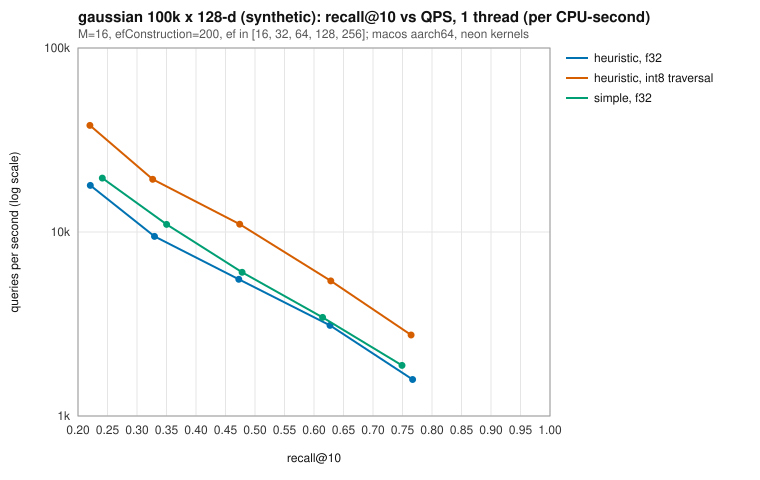
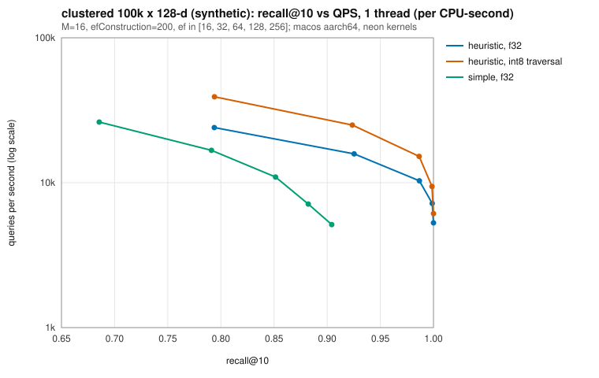

# hnsw-index

[](https://github.com/aozmekik/hnsw-index/actions/workflows/ci.yml)
[](LICENSE)

A from-scratch Rust implementation of HNSW graphs for approximate nearest
neighbour search, with SIMD distance kernels, filtered search, deletions and
a validated on-disk format.

> **Status:** early, version 0.1.0. The API may change. Not yet published to
> crates.io.

## Why it exists

HNSW (Malkov & Yashunin, 2018) is the graph index behind most vector search
systems. This crate implements it directly from the paper, as a compact,
readable codebase that is also careful about the parts papers leave out:
searching from many threads without data races, building in parallel without
deadlocks, deleting vectors, and loading index files that may be corrupt or
hostile without crashing. Its recall matches
[hnswlib](https://github.com/nmslib/hnswlib), the authors' C++ library, on
identical data ([below](#correctness)).

## Features

- **The paper's algorithms**: insertion with level sampling (`mL = 1/ln M`),
  greedy descent through the upper layers, ef-bounded search on layer 0, and
  both neighbour selection strategies, simple (Algorithm 3) and heuristic
  (Algorithm 4, with optional `extendCandidates` and `keepPrunedConnections`).
  Parameters `M`, `M0` and `efConstruction`.
- **Metrics**: squared L2, inner product and cosine over fixed-dimension `f32`
  vectors.
- **SIMD kernels**: a 16-accumulator loop that LLVM auto-vectorises, plus
  hand-written NEON (aarch64) and AVX2+FMA (x86_64) kernels chosen by runtime
  feature detection, each tested against a scalar reference.
- **Filtered search**: `search_filtered(query, k, ef, |key| ...)` applies the
  predicate during traversal, so it still returns `k` matches when most keys
  are rejected.
- **Deletion**: tombstones excluded from results immediately; `compact()`
  rebuilds without them.
- **Concurrency**: `HnswIndex` is `Send + Sync`; search takes `&self`.
  `insert_batch` links vectors in parallel with rayon; `search_batch` searches
  in parallel.
- **Persistence**: a versioned, CRC-32 checksummed binary format. Loading
  validates every field, so corrupt or malicious files produce errors, not
  panics or huge allocations.
- **Optional int8 scalar quantization**: graph traversal on 8-bit codes, then
  exact `f32` re-ranking.
- **Exact `BruteForceIndex`** for ground truth, `eval::recall_at_k`, and seeded
  synthetic datasets.
- Two runtime dependencies: `rayon` and `parking_lot`.

## Install

Not yet published to crates.io. Use it as a git dependency:

```toml
[dependencies]
hnsw-index = { git = "https://github.com/aozmekik/hnsw-index" }
```

The benchmark binary installs with

```sh
cargo install --git https://github.com/aozmekik/hnsw-index hnsw-bench
```

Requires Rust 1.88 or newer (edition 2024).

## Quick start

```rust
use hnsw_index::{HnswIndex, HnswParams, Metric};

fn main() -> Result<(), hnsw_index::Error> {
    let mut index = HnswIndex::new(3, Metric::Cosine, HnswParams::default())?;
    index.insert(1, &[1.0, 0.0, 0.0])?;
    index.insert(2, &[0.0, 1.0, 0.0])?;
    index.insert_batch(&[3, 4], &[0.9, 0.1, 0.0, 0.0, 0.0, 1.0])?; // flat, row-major

    // The 2 nearest neighbours, with a candidate list of size ef = 32.
    let hits = index.search(&[1.0, 0.05, 0.0], 2, 32)?;
    assert_eq!(hits[0].key, 1);

    // Only even keys.
    let even = index.search_filtered(&[1.0, 0.05, 0.0], 1, 32, |key| key % 2 == 0)?;
    assert_eq!(even[0].key, 2);

    index.remove(1);
    index.write_to(std::fs::File::create("vectors.hnsw")?)?;
    let loaded = HnswIndex::read_from(std::fs::File::open("vectors.hnsw")?)?;
    assert_eq!(loaded.search(&[1.0, 0.05, 0.0], 1, 32)?[0].key, 3);
    Ok(())
}
```

Runnable examples live in [`examples/`](examples): `quickstart`,
`filtered_search`, `persistence` and `quantization`
(`cargo run --release --example quickstart`).

## API overview

| Item | Purpose |
|---|---|
| `HnswIndex::new(dim, metric, params)` | Empty index; validates `dim` and parameters. |
| `HnswParams::new(m)` | `M`, with `M0 = 2M`, `mL = 1/ln M`, `efConstruction = 200`; builder methods `with_m0`, `with_ef_construction`, `with_level_multiplier`, `with_selection`, `with_seed`. |
| `insert(key, &[f32])`, `insert_batch(&keys, &flat)`, `reserve(n)` | Add vectors under caller-chosen `u64` keys. A batch is validated as a whole before anything is inserted and linked in parallel. |
| `search(q, k, ef)`, `search_filtered(q, k, ef, f)`, `search_with(q, k, &SearchOptions)`, `search_batch(&flat, k, ef)` | Approximate k-NN, closest first, as `Neighbor { key, distance }`. |
| `remove(key)`, `compact()` | Tombstone a key; rebuild without tombstones. |
| `enable_quantization()`, `SearchOptions::quantized(true)` | int8 traversal with exact re-ranking. |
| `write_to(w)`, `read_from(r)`, `to_bytes()`, `from_bytes(&[u8])` | Persistence. |
| `len`, `contains`, `get`, `stats`, `memory_usage`, `backend` | Introspection. |
| `BruteForceIndex` | Exact search with the same API shape. |
| `kernels::{Backend, Kernels}` | Distance primitives per SIMD backend. |
| `synthetic::Dataset`, `eval::recall_at_k` | Seeded test data and evaluation. |

Errors are a single `Error` enum (`DimensionMismatch`, `NonFiniteVector`,
`ZeroVector`, `DuplicateKey`, `Format(FormatError)`, ...). Distances for
`Metric::L2` are squared; inner product is reported as `-<a, b>` so that
smaller is always closer.

## Design notes

- **Graph storage and concurrency** ([ADR 0001](docs/adr/0001-graph-storage-and-concurrency.md)).
  Neighbour lists are fixed-capacity blocks of `AtomicU32` (count, then ids):
  one contiguous array for layer 0, a boxed slice per node for upper layers.
  Writers take a per-node lock and publish the count last; readers never lock.
  Relaxed atomic loads compile to plain loads, so search pays nothing for
  thread safety, and the graph code has no `unsafe`. Every critical section
  holds a single node lock, which makes parallel builds deadlock-free. An
  earlier version that held the inserted node's lock for its whole insertion
  (as hnswlib does) deadlocked under the property tests; the ADR explains why.
- **Levels by hashing.** A node's level is `⌊−ln(U)·mL⌋` with `U` derived from
  a hash of `(seed, id)`, not from a shared RNG, so levels do not depend on
  thread scheduling. Sequential builds are reproducible bit for bit; parallel
  builds are not (interleaving changes the graph) but match in quality.
- **Deletion** ([ADR 0002](docs/adr/0002-tombstone-deletion-and-compaction.md)).
  Tombstoned nodes keep routing searches but are never returned; `compact()`
  rebuilds from live vectors. In-place graph repair was not attempted.
- **File format** ([ADR 0003](docs/adr/0003-file-format.md)). Fixed header,
  columnar sections, CRC-32 trailer. The loader checks magic, version and
  checksum, then every invariant, and bounds allocations by the input size and
  a plausibility check of the level distribution.
- **Quantization** ([ADR 0004](docs/adr/0004-scalar-quantization.md)).
  Symmetric int8 codes with one global scale (per-dimension centring for L2),
  exact integer distances, used only to navigate; the final `ef` candidates
  are re-ranked with `f32` distances. It costs memory (codes are added) and
  buys speed.
- **Filters and tombstones** use the same mechanism: rejected nodes are
  expanded but never enter the result heap, and the search keeps going until it
  has `ef` admissible results or runs out of reachable nodes.

## Correctness

- **Tests** (`cargo test --all-targets`): unit tests with access to graph
  internals (structural invariants after every build mode, reachability,
  deterministic sequential builds), property tests with proptest (results
  sorted, at most `k`, unique, never tombstoned, filter respected, reported
  distances bit-identical to a recomputation, compaction keeps exactly the
  live keys, serialisation round trip, random truncation and byte mutation of
  files never panic), SIMD-versus-scalar equivalence for every available
  backend, concurrency tests, and a check of `memory_usage()` against a
  counting allocator.
- **Recall regression** (`tests/recall.rs`, fixed seed, 10k × 128 synthetic
  Gaussian vectors, 200 queries, `efConstruction = 200`): recall@10 ≥ 0.95 at
  `ef = 100` with `M = 32`. With `M = 16` the same data gives 0.89, which is
  what hnswlib gets too (next point), so that test pins parity instead.
- **Parity with hnswlib.** `scripts/compare_hnswlib.py` reimplements the
  dataset generator and runs hnswlib 0.8.0 on exactly the same vectors.
  Recall@10, synthetic Gaussian 10k × 128, 200 queries, `efConstruction = 200`,
  single-threaded builds:

  | ef | hnswlib, M=16 | this crate, M=16 | hnswlib, M=32 | this crate, M=32 |
  |---:|---:|---:|---:|---:|
  | 16 | 0.4830 | 0.4825 | 0.6030 | 0.5785 |
  | 32 | 0.6495 | 0.6500 | 0.7650 | 0.7610 |
  | 64 | 0.8045 | 0.8055 | 0.9130 | 0.9095 |
  | 100 | 0.8890 | 0.8900 | 0.9620 | 0.9620 |
  | 128 | 0.9175 | 0.9180 | 0.9800 | 0.9800 |
  | 256 | 0.9815 | 0.9815 | 0.9960 | 0.9960 |

  Commands: `.venv/bin/python scripts/compare_hnswlib.py --n 10000 --queries 200 --dim 128`
  (hnswlib 0.8.0, numpy 2.5.4, Python 3.13, in a throwaway venv) and
  `hnsw-bench --dataset gaussian --n 10000 --queries 200 --dim 128 --m {16,32} --ef 16,32,64,100,128,256 --skip-simple --repeats 1`.
  The two libraries draw node levels from different random streams, so their
  graphs differ. Treating the 2,000 query–neighbour pairs as independent, one
  standard error is about 0.011 at recall 0.6 and below 0.005 above 0.95.

  The same check on the 100k benchmark datasets (1,000 queries, `M = 16`,
  sequential build of this crate versus hnswlib built single-threaded):

  | ef | gaussian, hnswlib | gaussian, this crate | clustered, hnswlib | clustered, this crate |
  |---:|---:|---:|---:|---:|
  | 16 | 0.2283 | 0.2208 | 0.7933 | 0.7938 |
  | 32 | 0.3394 | 0.3296 | 0.9247 | 0.9253 |
  | 64 | 0.4750 | 0.4726 | 0.9864 | 0.9867 |
  | 128 | 0.6284 | 0.6271 | 0.9987 | 0.9988 |
  | 256 | 0.7673 | 0.7671 | 1.0000 | 1.0000 |

  Command: `.venv/bin/python scripts/compare_hnswlib.py --dataset {gaussian,clustered} --n 100000 --queries 1000 --dim 128 --m 16 --ef 16 32 64 128 256`;
  this crate's figures are from the benchmark run below. No speed comparison
  is made: hnswlib 0.8.0 enables its hand-written SIMD distance functions only
  on x86 (SSE/AVX/AVX-512), so on this arm64 machine it runs scalar loops and
  timing it would not be a fair comparison.

## Benchmarks

All numbers below are from **synthetic data** generated from a fixed seed, on
one machine: Apple M1 Pro (6 performance + 2 efficiency cores), 16 GB RAM,
macOS 26.6.2, rustc 1.99.1 (Homebrew, LLVM 23.1.3), release profile (thin
LTO, one codegen unit), NEON kernels. They describe this implementation on
this hardware, not real-world embedding workloads.

**Noise warning.** The machine was shared with other build jobs while these
were measured (1-minute load average 27 on 8 cores at the start and end of the
run). Wall-clock throughput suffers most, so single-threaded throughput is
also reported per CPU-second of the benchmark process (`getrusage`), which
only counts time the process actually ran. Across three complete runs of the
same command, recall of the sequentially built indexes was identical,
single-threaded queries per CPU-second differed by a median of 17% (at most
39%) for the same index, and 8-thread wall-clock throughput differed by up to
3.3x. Treat the 8-thread column as indicative only.

### Method

```sh
cargo build --release --locked
./target/release/hnsw-bench --threads 8 --out docs/bench
```

- Datasets: 100,000 base vectors and 1,000 queries, 128 dimensions, seed 42.
  `gaussian` has i.i.d. standard normal components (no structure, a hard
  case); `clustered` is a mixture of 100 Gaussian clusters (standard normal
  centres, spread 0.35). Queries are drawn after the base set from the same
  distribution, so they are disjoint from it.
- Index: L2, `M = 16`, `M0 = 32`, `efConstruction = 200`, k = 10. Ground truth
  from `BruteForceIndex`.
- Each throughput figure is the median of 3 timed passes over all 1,000
  queries, after one untimed pass that also measures recall.
- Memory is measured with a counting global allocator: heap bytes held by the
  index after the build, divided by the number of vectors.

The complete output (including the parallel-built index and the exact search
baseline) is in [`docs/bench/results.md`](docs/bench/results.md) and
[`docs/bench/results.csv`](docs/bench/results.csv).

### Build time and memory

| dataset | build | wall time | CPU time | heap bytes / vector |
|---|---|---:|---:|---:|
| gaussian | sequential (`insert` loop) | 47.8 s | 42.5 s | 701 |
| gaussian | parallel (`insert_batch`, 8 threads) | 6.6 s | 40.7 s | 715 |
| clustered | sequential | 17.7 s | 13.5 s | 701 |
| clustered | parallel, 8 threads | 4.3 s | 13.2 s | 715 |

Of the 701 bytes per vector, 512 are the `f32` vector itself and 132 the
layer-0 adjacency block (`(M0 + 1) × 4`); keys, levels, flags, locks, upper
layers and the key map make up the rest. The parallel build also keeps one
search buffer per thread. `memory_usage()` reported the same figures as the
allocator.

### Recall and throughput

`HnswIndex` built sequentially with the heuristic; "int8" is quantized
traversal with exact re-ranking on the same index; "simple" is a separate,
parallel build with simple neighbour selection.

**gaussian, 100k × 128**

| ef | recall@10 | QPS per CPU-s, 1 thread | QPS, 8 threads (wall) | int8 recall@10 | int8 QPS per CPU-s | simple recall@10 |
|---:|---:|---:|---:|---:|---:|---:|
| 16 | 0.2208 | 17,915 | 50,766 | 0.2202 | 37,955 | 0.2412 |
| 32 | 0.3296 | 9,464 | 44,227 | 0.3266 | 19,347 | 0.3501 |
| 64 | 0.4726 | 5,530 | 18,607 | 0.4740 | 11,027 | 0.4782 |
| 128 | 0.6271 | 3,109 | 14,126 | 0.6284 | 5,426 | 0.6145 |
| 256 | 0.7671 | 1,579 | 6,945 | 0.7646 | 2,755 | 0.7491 |

**clustered, 100k × 128**

| ef | recall@10 | QPS per CPU-s, 1 thread | QPS, 8 threads (wall) | int8 recall@10 | int8 QPS per CPU-s | simple recall@10 |
|---:|---:|---:|---:|---:|---:|---:|
| 16 | 0.7938 | 24,027 | 76,767 | 0.7939 | 39,163 | 0.6855 |
| 32 | 0.9253 | 15,813 | 69,091 | 0.9236 | 24,996 | 0.7911 |
| 64 | 0.9867 | 10,302 | 31,334 | 0.9865 | 15,192 | 0.8514 |
| 128 | 0.9988 | 7,194 | 28,844 | 0.9986 | 9,418 | 0.8822 |
| 256 | 1.0000 | 5,282 | 25,124 | 1.0000 | 6,126 | 0.9043 |

<p>
  
  
</p>

The charts are written by `hnsw-bench --out` from the same run;
8-thread versions are next to them in [`docs/bench`](docs/bench).

What the numbers show, within the noise above:

- **Isotropic Gaussian data is hard.** At 100k × 128 even `ef = 256` reaches
  recall@10 0.77 with `M = 16`. hnswlib measures the same on the same vectors
  (see [Correctness](#correctness)), so this is the dataset, not the
  implementation. Larger `M` or `ef` buys recall at the cost of speed.
- **The selection heuristic matters on clustered data**: simple selection
  reaches only 0.90 recall@10 at `ef = 256` where the heuristic reaches 1.0,
  the effect the paper describes. On structureless Gaussian data the two are
  close.
- **int8 traversal** gave 1.2x to 2.1x more queries per CPU-second at
  essentially the same recall (largest at small `ef` on the Gaussian data),
  because 128-byte codes stress memory and caches less than 512-byte vectors.
  It adds 128 bytes per vector.
- **Parallel builds** were 7.3x (Gaussian) and 4.2x (clustered) faster in wall
  time on 8 cores with recall within 0.01 of the sequential build at every
  `ef`, as listed in `docs/bench/results.md`.
- Exact search on 8 threads managed 2,906 (Gaussian) and 1,276 (clustered)
  queries per second in the same run.

### Distance kernels

`cargo bench --bench kernels` (Criterion's point estimate of the time per
call; same machine and load conditions):

| kernel | dim | scalar | portable (auto-vectorised) | NEON |
|---|---:|---:|---:|---:|
| dot | 128 | 58.1 ns | 10.2 ns | 10.5 ns |
| dot | 768 | 659 ns | 47.8 ns | 47.7 ns |
| l2_squared | 128 | 65.1 ns | 12.4 ns | 12.0 ns |
| l2_squared | 768 | 639 ns | 50.4 ns | 60.6 ns |

On this CPU, LLVM's auto-vectorisation of the 16-accumulator loop is as fast
as the hand-written NEON kernels, or faster (768-d L2; that NEON figure also
had the widest 95% confidence interval, 56.6 to 66.4 ns). The scalar reference is 5x to 14x
slower because strict IEEE summation order prevents vectorisation. The AVX2
kernels were not benchmarked: there is no x86 machine in this setup, and they
are only built and tested by CI.

## Limitations

- Vectors live in memory as `f32`; there is no memory-mapped or on-disk search.
- No in-place deletion repair: tombstones cost memory and search time until
  `compact()`, which rebuilds the whole graph.
- Parallel builds are not reproducible bit for bit (sequential builds are).
- Quantization adds memory rather than saving it, and its single global scale
  suits data with similar per-dimension ranges (like the synthetic benchmarks)
  better than skewed real embeddings.
- Inner product is not a metric; HNSW quality for maximum inner product search
  depends on the data and was only tested on synthetic Gaussian vectors.
- The AVX2 kernels are exercised by CI on x86_64 runners; the numbers in this
  README come from an Apple M1 Pro, so only the NEON path was benchmarked.
- All measurements use synthetic data; no real embedding datasets (SIFT,
  GloVe, ...) were benchmarked yet.

## Roadmap

Deliberately left out of 0.1.0:

- in-place repair of deleted nodes (reusing slots instead of rebuilding);
- benchmarks on standard datasets (SIFT1M, GloVe) via ann-benchmarks' HDF5
  files;
- software prefetching of neighbour vectors during search;
- `cargo-fuzz` targets for the loader (needs nightly; property-based mutation
  testing covers it for now);
- quantization that replaces the `f32` vectors (memory savings) and
  per-dimension scales;
- streaming `read_from` without buffering the whole file.

## Contributing

See [CONTRIBUTING.md](CONTRIBUTING.md) for build, test, lint and benchmark
commands. Changes are tracked in [CHANGELOG.md](CHANGELOG.md).

## References

- Yu. A. Malkov and D. A. Yashunin, "Efficient and robust approximate nearest
  neighbor search using Hierarchical Navigable Small World graphs", IEEE
  Transactions on Pattern Analysis and Machine Intelligence 42(4), 2018.
  [arXiv:1603.09320](https://arxiv.org/abs/1603.09320). The algorithms and
  parameter names follow this paper.
- [hnswlib](https://github.com/nmslib/hnswlib): the authors' C++
  implementation. Used as a black-box reference for recall and as background
  for the concurrency design (a per-node writer lock and a global lock for
  entry-point promotion); no code was copied.
- G. L. Steele, D. Lea and C. H. Flood, "Fast splittable pseudorandom number
  generators", OOPSLA 2014 (SplitMix64, used for datasets and level hashing).
- M. E. Kounavis and F. L. Berry, "Novel table lookup-based algorithms for
  high-performance CRC generation", IEEE Transactions on Computers, 2008
  (slicing-by-8 CRC-32).
- S. Jayaram Subramanya et al., "DiskANN" (NeurIPS 2019) and A. Singh et al.,
  "FreshDiskANN" (2021), for the in-place deletion alternative discussed in
  ADR 0002.

## License

MIT, see [LICENSE](LICENSE).

Built by [Ahmed Semih Özmekik](https://github.com/aozmekik) at [Fergani](https://fergani.tr).
