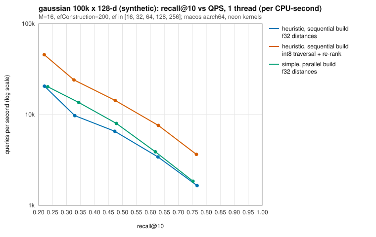

# Benchmarks

Everything here was measured on **synthetic data** generated from a fixed
seed, on one machine: Apple M1 Pro (6 performance and 2 efficiency cores),
16 GB RAM, macOS 26.6.2, rustc 1.99.1 (Homebrew, LLVM 23.1.3), release
profile (thin LTO, one codegen unit), NEON kernels (`Kernels::best()` on this
CPU). The figures describe this implementation on this hardware, not
real-world embedding workloads.

- [Method](#method)
- [Noise](#noise)
- [Build time and memory](#build-time-and-memory)
- [Recall and throughput](#recall-and-throughput)
- [Recall compared with hnswlib](#recall-compared-with-hnswlib)
- [Distance kernels](#distance-kernels)

## Method

```sh
cargo build --release --locked
for run in 1 2 3; do
  ./target/release/hnsw-bench --threads 8 --out docs/bench/run-$run
done
python3 scripts/bench_summary.py docs/bench/run-1 docs/bench/run-2 docs/bench/run-3 > docs/bench/summary.md
```

- Datasets: 100,000 base vectors and 1,000 queries, 128 dimensions, seed 42.
  `gaussian` has i.i.d. standard normal components (no structure, a hard
  case); `clustered` is a mixture of 100 Gaussian clusters (standard normal
  centers, spread 0.35). Queries are drawn after the base set from the same
  distribution, so they are disjoint from it.
- Index: L2, `M = 16`, `M0 = 32`, `efConstruction = 200`, k = 10. Ground
  truth from `BruteForceIndex`.
- Indexes measured per dataset: the heuristic built sequentially (an
  `insert` loop) and in parallel (`insert_batch` on 8 threads), the
  sequential one again with int8 traversal and exact re-ranking, and simple
  neighbor selection built in parallel.
- Within a run, each throughput figure is the median of 3 timed passes over
  all 1,000 queries, after one untimed pass that also measures recall.
  Single-threaded throughput is also reported per CPU-second of the
  benchmark process (`getrusage`), which leaves out time spent waiting for a
  core.
- Memory is measured with a counting global allocator: heap bytes held by the
  index after the build, divided by the number of vectors.
- The whole benchmark ran three times. The tables below give the median of
  the three runs and, in parentheses, the range; a single value means all
  three runs agreed at the precision shown. Queries per second are rounded
  to two significant digits. The raw output of every run, including the
  load average at its start and end, is in [`bench/run-1`](bench/run-1),
  [`bench/run-2`](bench/run-2) and [`bench/run-3`](bench/run-3); the full
  summary is [`bench/summary.md`](bench/summary.md).

## Noise

The machine was shared with other build and test jobs throughout. The
1-minute load average (runnable threads, on 8 cores) was 11.5 and 13.9 at
the start and end of run 1, 13.9 and 12.3 for run 2, and 12.3 and 20.1 for
run 3. That affects the figures in three ways:

- **Wall-clock time** includes waiting for a core. Single-threaded loops
  wait less than 8-thread ones, which compete with everything else.
- **CPU time** leaves out waiting, but not slowdowns while running: macOS may
  run the single-threaded loop on an efficiency core, and other processes
  compete for caches and memory bandwidth. Both inflate CPU time.
- So even single-threaded queries per CPU-second vary between runs: across
  the 40 configurations, the fastest run was a median of 1.14 times the
  slowest, and at worst 1.70 times. For 8-thread wall-clock throughput the
  same ratio was 1.45 at the median and 5.4 at worst; treat that column as
  indicative only.

Recall does not depend on load. Sequential builds are deterministic, and
their recall was identical in all three runs.

## Build time and memory

| dataset | build | threads | wall time (s) | CPU time (s) | heap bytes / vector |
|---|---|---:|---:|---:|---:|
| gaussian | heuristic, sequential | 1 | 37.7 (37.2–40.9) | 36.2 (36.2–38.8) | 701 |
| gaussian | heuristic, parallel | 8 | 7.2 (6.5–8.1) | 39.1 (38.5–39.8) | 715 |
| gaussian | simple, parallel | 8 | 7.0 (5.0–7.8) | 32.1 (29.7–32.8) | 715 |
| clustered | heuristic, sequential | 1 | 12.6 (11.6–12.7) | 12.1 (11.4–12.4) | 701 |
| clustered | heuristic, parallel | 8 | 3.4 (2.5–4.0) | 12.9 (12.7–13.6) | 715 |
| clustered | simple, parallel | 8 | 2.8 (2.6–3.4) | 12.6 (12.2–13.1) | 715 |

- The parallel build used about as much CPU time as the sequential one (1%
  to 14% more), spread over 8 threads. In each run, its wall time was 5.1 to
  5.8 times shorter on the Gaussian data and 3.2 to 5.0 times shorter on the
  clustered data. With 6 performance cores and other jobs running, these
  ratios measure this machine's load as much as the build's scalability.
- Of the 701 bytes per vector, 512 are the `f32` vector and 132 the layer-0
  adjacency block (`(M0 + 1) × 4`); keys, levels, flags, locks, upper layers
  and the key map make up the rest. The parallel build also keeps a search
  buffer per thread. `memory_usage()` reported the same figures as the
  allocator.

## Recall and throughput

"f32" is the sequentially built heuristic index; "int8" is quantized
traversal with exact re-ranking on that same index; "simple" is the
parallel build with simple neighbor selection. Throughput is single-threaded
queries per CPU-second unless marked as 8-thread wall clock.

**gaussian, 100k × 128**

| ef | f32 recall@10 | f32 QPS | f32 QPS, 8 threads (wall) | int8 recall@10 | int8 QPS | simple recall@10 |
|---:|---:|---:|---:|---:|---:|---:|
| 16 | 0.2208 | 23k (21k–26k) | 42k (42k–90k) | 0.2202 | 46k (45k–56k) | 0.2330 (0.2327–0.2366) |
| 32 | 0.3296 | 11k (9.7k–12k) | 62k (32k–70k) | 0.3266 | 28k (24k–32k) | 0.3435 (0.3420–0.3474) |
| 64 | 0.4726 | 7.5k (6.5k–8.0k) | 36k (27k–39k) | 0.4740 | 14k (12k–16k) | 0.4783 (0.4773–0.4787) |
| 128 | 0.6271 | 3.4k (3.4k–3.7k) | 17k (11k–20k) | 0.6284 | 7.5k (4.5k–7.6k) | 0.6177 (0.6138–0.6244) |
| 256 | 0.7671 | 1.8k (1.7k–2.0k) | 9.0k (6.2k–9.4k) | 0.7646 | 3.6k (3.1k–4.1k) | 0.7524 (0.7505–0.7553) |

**clustered, 100k × 128**

| ef | f32 recall@10 | f32 QPS | f32 QPS, 8 threads (wall) | int8 recall@10 | int8 QPS | simple recall@10 |
|---:|---:|---:|---:|---:|---:|---:|
| 16 | 0.7938 | 27k (25k–28k) | 92k (85k–103k) | 0.7939 | 46k (42k–50k) | 0.6914 (0.6748–0.7105) |
| 32 | 0.9253 | 17k | 71k (68k–81k) | 0.9236 | 29k (26k–30k) | 0.7960 (0.7796–0.8177) |
| 64 | 0.9867 | 11k | 43k (26k–53k) | 0.9865 | 16k (16k–18k) | 0.8545 (0.8447–0.8811) |
| 128 | 0.9988 | 7.8k (7.5k–8.2k) | 32k (22k–41k) | 0.9986 | 11k (9.5k–11k) | 0.8847 (0.8831–0.9178) |
| 256 | 1.0000 | 5.7k (5.4k–5.9k) | 25k (20k–27k) | 1.0000 | 6.6k (6.5k–6.7k) | 0.9095 (0.9080–0.9366) |

<p>
  
  
</p>

The charts are written by `hnsw-bench --out` and show run 1 only; every run
has its own, including 8-thread versions.

What the numbers show, within the noise above:

- **Isotropic Gaussian data is hard.** At 100k × 128 even `ef = 256` reaches
  recall@10 0.77 with `M = 16`. hnswlib measures the same on the same vectors
  ([below](#recall-compared-with-hnswlib)), so this is the dataset, not the
  implementation. Larger `M` or `ef` buys recall at the cost of speed.
- **The selection heuristic matters on clustered data**: simple selection
  reaches 0.91 recall@10 at `ef = 256` where the heuristic reaches 1.0, the
  effect the paper describes. On structureless Gaussian data the two are
  close.
- **int8 traversal** gave 1.2 to 2.4 times more queries per CPU-second
  (comparing medians) at essentially the same recall, most on the Gaussian
  data and at small `ef` on the clustered data: 128-byte codes stress memory
  and caches less than 512-byte vectors. It adds 128 bytes per vector.
- **Parallel builds** reached recall within 0.013 of the sequential build at
  every `ef`, in every run (see `bench/summary.md`).
- **Exact search** (`BruteForceIndex::search_batch`, 8 threads) managed
  between 1,700 and 3,000 queries per second across runs and datasets. It
  does identical work for both datasets, so that spread is the noise of an
  8-thread wall-clock measurement on this machine.

## Recall compared with hnswlib

`scripts/compare_hnswlib.py` reimplements the dataset generator in Python
and runs [hnswlib](https://github.com/nmslib/hnswlib) 0.8.0 (the paper
authors' C++ library) on exactly the same vectors, built single-threaded,
with the same `M`, `efConstruction = 200` and k = 10. This crate's figures
are from sequential builds, so they are deterministic.

**Gaussian, 10k × 128, 200 queries**

| ef | hnswlib, M=16 | this crate, M=16 | hnswlib, M=32 | this crate, M=32 |
|---:|---:|---:|---:|---:|
| 16 | 0.4830 | 0.4825 | 0.6030 | 0.5785 |
| 32 | 0.6495 | 0.6500 | 0.7650 | 0.7610 |
| 64 | 0.8045 | 0.8055 | 0.9130 | 0.9095 |
| 100 | 0.8890 | 0.8900 | 0.9620 | 0.9620 |
| 128 | 0.9175 | 0.9180 | 0.9800 | 0.9800 |
| 256 | 0.9815 | 0.9815 | 0.9960 | 0.9960 |

```sh
# hnswlib 0.8.0 and numpy 2.5.4 on Python 3.14, in a throwaway virtual environment
.venv/bin/python scripts/compare_hnswlib.py --n 10000 --queries 200 --dim 128
# this crate
for m in 16 32; do
  ./target/release/hnsw-bench --dataset gaussian --n 10000 --queries 200 --dim 128 \
    --m $m --ef 16,32,64,100,128,256 --skip-simple --repeats 1
done
```

**100k × 128, 1,000 queries, `M = 16`** (this crate's figures are the
benchmark above)

| ef | gaussian, hnswlib | gaussian, this crate | clustered, hnswlib | clustered, this crate |
|---:|---:|---:|---:|---:|
| 16 | 0.2283 | 0.2208 | 0.7933 | 0.7938 |
| 32 | 0.3394 | 0.3296 | 0.9247 | 0.9253 |
| 64 | 0.4750 | 0.4726 | 0.9864 | 0.9867 |
| 128 | 0.6284 | 0.6271 | 0.9987 | 0.9988 |
| 256 | 0.7673 | 0.7671 | 1.0000 | 1.0000 |

```sh
for dataset in gaussian clustered; do
  .venv/bin/python scripts/compare_hnswlib.py --dataset $dataset --n 100000 --queries 1000 \
    --dim 128 --m 16 --ef 16 32 64 128 256 --repeats 1
done
```

At `ef >= 32` this crate is within 0.01 of hnswlib in every configuration.
At `ef = 16` it is up to 0.025 lower (10k, `M = 32`). The two libraries draw
node levels from different random streams, so their graphs differ;
treating the 2,000 query–neighbor pairs of the 10k runs as independent, one
standard error is about 0.011 at recall 0.6 and below 0.005 above 0.95.

No speed comparison is made: hnswlib 0.8.0 has hand-written SIMD distance
functions only for x86 (SSE, AVX, AVX-512), so on this arm64 machine it runs
scalar loops.

## Distance kernels

Time per call in nanoseconds, from Criterion's point estimate, as the median
(range) of three runs taken back to back while the 1-minute load average
fell from 11.4 to 8.3:

```sh
for run in 1 2 3; do cargo bench --bench kernels -- --save-baseline k$run; done
```

| kernel | dim | scalar | portable (auto-vectorized) | NEON |
|---|---:|---:|---:|---:|
| dot | 128 | 59.4 (57.3–63.0) | 10.5 (10.2–11.1) | 10.9 (10.6–14.5) |
| dot | 768 | 629 (611–666) | 51.8 (47.6–58.4) | 51.4 (49.3–65.1) |
| l2_squared | 128 | 65.3 (64.5–68.1) | 11.5 (11.4–11.6) | 10.7 (10.6–11.1) |
| l2_squared | 768 | 635 (630–640) | 52.1 (50.6–58.7) | 53.7 (52.4–54.6) |

- The hand-written NEON kernels and LLVM's auto-vectorization of the
  16-accumulator portable loop are within 7% of each other in either
  direction, which is within the run-to-run noise. `Kernels::best()` still
  prefers NEON: its instruction sequence (fused multiply-adds, which round
  once instead of twice) does not depend on what the auto-vectorizer makes
  of a loop.
- The scalar reference is 5 to 12 times slower, because strict IEEE
  summation order prevents vectorization.
- The AVX2 kernels were not benchmarked: no x86 machine was available.
